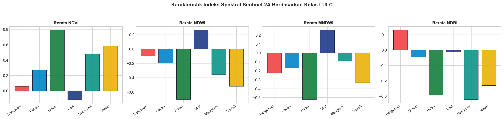

# Data Preparation: Rekayasa Fitur Spektral & Mitigasi Kebocoran Spasial

Tahap **Data Preparation** mencakup prosedur penyiapan lingkungan komputasi sains data, pemuatan dataset piksel satelit Sentinel-2A Level-2A asli, analisis eksplorasi data (*Exploratory Data Analysis* - EDA) respon spektral, pemahaman bahaya autokorelasi spasial, serta pembagian subset data latih dan uji menggunakan teknik *Spatial Group Splitting*.

---

## 1. Setup Dependencies & Lingkungan Kerja

Seluruh alur kerja pemrosesan data, pemodelan ensemble, dan visualisasi spasial memanfaatkan pustaka Python standar industri sains data geospasial:

```python
# ==============================================================================
# FASE 3.1 SETUP DEPENDENCIES & LINGKUNGAN KERJA
# ==============================================================================
import base64
import io
import json
import warnings
from pathlib import Path

import folium
from folium.raster_layers import ImageOverlay
import joblib
import matplotlib.pyplot as plt
import numpy as np
import pandas as pd
from PIL import Image
from scipy.spatial import ConvexHull
import seaborn as sns
from sklearn.ensemble import (
    HistGradientBoostingClassifier,
    RandomForestClassifier,
    VotingClassifier,
)
from sklearn.metrics import (
    accuracy_score,
    classification_report,
    confusion_matrix,
    f1_score,
    precision_score,
    recall_score,
)
from sklearn.model_selection import GroupShuffleSplit

warnings.filterwarnings("ignore")
plt.style.use("seaborn-v0_8-whitegrid" if "seaborn-v0_8-whitegrid" in plt.style.available else "default")

# Setup direktori keluaran evaluasi
OUT_DIR = Path("hasil_evaluasi")
OUT_DIR.mkdir(parents=True, exist_ok=True)

print("✅ Pustaka data sains spasial dan direktori artefak berhasil disiapkan!")
```

**Keluaran Terminal:**
```text
✅ Pustaka data sains spasial dan direktori artefak berhasil disiapkan!
```

---

## 2. Memuat Dataset Piksel Sentinel-2A Level-2A

Dataset diekstraksi dari citra satelit Sentinel-2A produk Level-2A (BOA) yang mencakup 285.491 piksel observasi pada seluruh penjuru Provinsi Jawa Timur yang tersimpan dalam format berkas terstruktur `data/piksel_s2.csv`:

```python
# ==============================================================================
# FASE 3.2 MEMUAT DATASET PIKSEL SENTINEL-2A ASLI
# ==============================================================================
DATA_PATH = Path("data/piksel_s2.csv")
assert DATA_PATH.exists(), f"File {DATA_PATH} tidak ditemukan!"

df = pd.read_csv(DATA_PATH)
print("=" * 70)
print(f"Dataset Citra Satelit Sentinel-2A Level-2A Jawa Timur")
print("=" * 70)
print(f"Total Sampel Piksel: {len(df):,} baris")
print(f"Jumlah Fitur / Kolom: {df.shape[1]} kolom")
print(f"Kolom Tersedia      : {df.columns.tolist()}\n")

print("Sebaran Jumlah Piksel per Kelas Tutupan Lahan:")
distribusi = df["label_teks"].value_counts().reset_index()
distribusi.columns = ["Kelas", "Jumlah Piksel"]
distribusi["Persentase (%)"] = (distribusi["Jumlah Piksel"] / len(df) * 100).round(2)
print(distribusi.to_string(index=False))
```

### Karakteristik Struktur Data & Sebaran Frekuensi Kelas:
* **Total Sampel Piksel:** **285.491 baris**
* **Jumlah Fitur / Kolom:** **19 kolom** (`poligon_id`, `poligon_no`, `sampel_id`, `tile_id`, `label`, `label_teks`, `px_row`, `px_col`, `lon`, `lat`, `B02`, `B03`, `B04`, `B08`, `B11`, `NDVI`, `NDWI`, `MNDWI`, `NDBI`)

| Kelas Tutupan Lahan | Jumlah Piksel | Persentase Relatif (%) | Karakteristik Sebaran |
| :--- | :---: | :---: | :--- |
| **Laut** | 128.000 | 44.84% | Mayoritas (Pesisir dan laut terbuka) |
| **Sawah** | 43.755 | 15.33% | Dataran aluvial sentra pangan |
| **Hutan** | 37.760 | 13.23% | Kawasan pegunungan vulkanik |
| **Danau** | 37.678 | 13.20% | Waduk dan badan air daratan |
| **Mangrove** | 36.498 | 12.78% | Muara sungai dan pasang surut |
| **Bangunan** | 1.800 | 0.63% | Minoritas ekstrem (Kawasan inti terbangun) |

> **Catatan Ketimpangan Kelas (*Class Imbalance*):**  
> Terlihat disparitas frekuensi yang ekstrem antara kelas mayoritas (Laut 44.84%) dan kelas minoritas (Bangunan 0.63%). Kondisi ini menjadi pertimbangan fundamental mengapa algoritma Machine Learning yang digunakan pada tahap pemodelan wajib menerapkan pembobotan kelas seimbang (`class_weight='balanced'`).

---

## 3. Exploratory Data Analysis (EDA) & Rerata Respon Spektral

Untuk memahami profil reflektansi permukaan dan separabilitas biofisik, dihitung nilai rata-rata dari 9 fitur input (`FEATURE_COLS = ["B02", "B03", "B04", "B08", "B11", "NDVI", "NDWI", "MNDWI", "NDBI"]`) untuk setiap kelas:

```python
# ==============================================================================
# FASE 3.3 EXPLORATORY DATA ANALYSIS (EDA) & RERATA RESPON SPEKTRAL
# ==============================================================================
FEATURE_COLS = ["B02", "B03", "B04", "B08", "B11", "NDVI", "NDWI", "MNDWI", "NDBI"]

# Menampilkan statistik deskriptif spektral per kelas
stat_spektral = df.groupby("label_teks")[FEATURE_COLS].mean().round(3)
print("Profil Respon Spektral Rerata per Kelas Tutupan Lahan:")
display(stat_spektral)

# Visualisasi Bar Plot Rerata Indeks Spektral
fig, axes = plt.subplots(1, 4, figsize=(18, 4), dpi=150)
indeks_list = ["NDVI", "NDWI", "MNDWI", "NDBI"]
warna_kelas = {
    "Sawah": "#eab308", "Bangunan": "#ef4444", "Hutan": "#15803d", 
    "Danau": "#0284c7", "Laut": "#1e3a8a", "Mangrove": "#0d9488"
}

for i, idx_name in enumerate(indeks_list):
    ax = axes[i]
    rerata = df.groupby("label_teks")[idx_name].mean()
    colors = [warna_kelas.get(c, "#64748b") for c in rerata.index]
    ax.bar(rerata.index, rerata.values, color=colors, edgecolor="#0f172a", alpha=0.9)
    ax.set_title(f"Rerata {idx_name}", fontsize=11, fontweight="bold")
    ax.set_xticklabels(rerata.index, rotation=35, ha="right", fontsize=9)
    ax.axhline(0, color="black", linestyle="--", linewidth=0.8)

plt.suptitle("Karakteristik Indeks Spektral Sentinel-2A Berdasarkan Kelas LULC", fontsize=13, fontweight="bold", y=1.05)
plt.tight_layout()
plt.show()
```

### Tabel Profil Respon Spektral Rerata per Kelas Tutupan Lahan:

| Kelas Tutupan Lahan | B02 (Blue) | B03 (Green) | B04 (Red) | B08 (NIR) | B11 (SWIR-1) | NDVI | NDWI | MNDWI | NDBI |
| :--- | :---: | :---: | :---: | :---: | :---: | :---: | :---: | :---: | :---: |
| **Bangunan** | 1436.733 | 1572.429 | 1675.856 | 1852.271 | **2352.748** | 0.059 | -0.096 | -0.223 | **+0.131** |
| **Danau** | 443.853 | 634.535 | 567.014 | 1634.050 | 1371.701 | 0.272 | -0.196 | -0.166 | -0.046 |
| **Hutan** | 336.818 | 516.170 | 341.778 | **2916.824** | 1566.548 | **+0.792** | -0.703 | -0.521 | -0.292 |
| **Laut** | 497.624 | 419.262 | 306.642 | 254.013 | 270.183 | -0.113 | **+0.266** | **+0.257** | -0.008 |
| **Mangrove** | 460.196 | 710.394 | 496.072 | 2126.043 | 1026.790 | +0.481 | -0.358 | -0.089 | -0.321 |
| **Sawah** | 695.057 | 878.325 | 734.096 | 2837.957 | 1801.278 | +0.584 | -0.520 | -0.335 | -0.231 |



### Temuan Analisis Biofisik EDA:
1. **Pembeda Kawasan Terbangun (Bangunan)**: Bangunan adalah satu-satunya kelas dengan **NDBI bernilai positif (+0.131)** dan pantulan saluran **B11 (SWIR-1) tertinggi (2352.748)**. Nilai NDVI-nya sangat rendah (+0.059), membuktikan tidak adanya kanopi aktif klorofil.
2. **Pembeda Perairan (Laut & Danau)**: Laut memiliki nilai **NDWI (+0.266)** dan **MNDWI (+0.257)** positif, dengan absorpsi total pada B08 NIR (254.013). Danau pedalaman memiliki respon sedikit lebih tinggi pada B08 karena kandungan fitoplankton/sedimen alga.
3. **Pembeda Vegetasi (Hutan, Sawah, & Mangrove)**: Hutan memiliki **NDVI tertinggi (+0.792)** dengan penyerapan maksimum di saluran Red B04 (341.778). Sawah berada di tingkat menengah (NDVI +0.584) karena fase penggenangan air dan pematang, sementara Mangrove memiliki B11 lebih rendah (1026.790) akibat serapan substrat lumpur pasang surut.

---

## 4. Partisi Data: Spatial Group Splitting Berbasis Poligon Mandiri

### Mengapa Harus Spatial Group Splitting?
Dalam analisis geospasial penginderaan jauh, piksel-piksel yang berada di dalam satu poligon hamparan yang sama memiliki autokorelasi spasial yang sangat tinggi (**Hukum Pertama Tobler**: *objek yang berdekatan secara spasial lebih mirip dibandingkan objek yang berjauhan*).

Jika kita menggunakan pemisahan acak tingkat piksel (`train_test_split` acak), piksel-piksel dari poligon yang sama akan terbelah ke dalam subset data latih dan data uji. Akibatnya model mengalami **kebocoran data spasial (*spatial data leakage*)**, di mana model hanya sekadar menghafal piksel tetangga terdekat, menghasilkan akurasi semu (overoptimistik) yang runtuh ketika diterapkan pada wilayah geografis baru.

Solusi saintifik yang diterapkan adalah **`GroupShuffleSplit`** berbasis kolom **`poligon_id`**:
* **Seluruh piksel dari satu poligon dijamin 100% hanya masuk ke subset pelatihan atau subset pengujian.**
* Data uji benar-benar mandiri secara geografis (*spatially independent unseen polygons*).

```python
# ==============================================================================
# FASE 3.4 PEMBAGIAN DATA LATIH & UJI BERBASIS KELOMPOK POLIGON
# ==============================================================================
X = df[FEATURE_COLS]
y = df["label"]
groups = df["poligon_id"]

gss = GroupShuffleSplit(n_splits=1, test_size=0.20, random_state=42)
train_idx, test_idx = next(gss.split(X, y, groups))

df_train = df.iloc[train_idx].copy()
df_test = df.iloc[test_idx].copy()

X_train, y_train = df_train[FEATURE_COLS], df_train["label"]
X_test, y_test = df_test[FEATURE_COLS], df_test["label"]

print(f"Data Latih (Training): {len(X_train):,} piksel ({len(df_train['poligon_id'].unique())} poligon mandiri)")
print(f"Data Uji (Testing)   : {len(X_test):,} piksel ({len(df_test['poligon_id'].unique())} poligon mandiri)")

split_summary = pd.DataFrame({
    "Data Latih (Train)": df_train["label_teks"].value_counts(),
    "Data Uji (Test)": df_test["label_teks"].value_counts()
}).fillna(0).astype(int)
split_summary["Total"] = split_summary["Data Latih (Train)"] + split_summary["Data Uji (Test)"]
print("\nDistribusi Jumlah Data Training vs Testing per Kelas:")
display(split_summary)
```

**Keluaran Eksekusi Split:**
```text
Data Latih (Training): 227,636 piksel (237 poligon mandiri)
Data Uji (Testing)   : 57,855 piksel (60 poligon mandiri)
```

### Tabel Distribusi Jumlah Piksel Training vs Testing per Kelas:

| Kelas Tutupan Lahan | Data Latih (Train) | Data Uji (Test) | Total Piksel | Proporsi Uji (%) |
| :--- | :---: | :---: | :---: | :---: |
| **Bangunan** | 1.470 | 330 | 1.800 | 18.33% |
| **Danau** | 27.407 | 10.271 | 37.678 | 27.26% |
| **Hutan** | 34.453 | 3.307 | 37.760 | 8.76% |
| **Laut** | 98.000 | 30.000 | 128.000 | 23.44% |
| **Mangrove** | 30.850 | 5.648 | 36.498 | 15.47% |
| **Sawah** | 35.456 | 8.299 | 43.755 | 18.97% |
| **Total Keseluruhan** | **227.636** | **57.855** | **285.491** | **20.26%** |

Dengan partisi ini, terdapat 60 poligon mandiri di Jawa Timur (terdiri atas 57.855 piksel pengujian) yang sepenuhnya terisolasi dari proses pembelajaran model.
