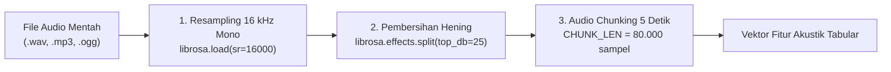

# Data Preparation: Pra-pemrosesan Sinyal Audio & Rekayasa Fitur Akustik

Tahap **Data Preparation** mencakup seluruh rangkaian transformasi sinyal audio mentah menjadi data tabular terstruktur yang siap dilatih oleh algoritma pembelajaran mesin. Tahapan ini mengimplementasikan strategi pencegahan kebocoran data (*Anti Data Leakage*), pemrosesan sinyal digital (*Digital Signal Processing* / DSP), perumusan landasan teori matematika 32 fitur akustik dasar, serta pembuatan modul terpusat `features.py`.

---

## 1. Strategi Pembagian Data Anti Kebocoran (*Anti Data Leakage*)

Dalam pemrosesan sinyal deret waktu audio, terdapat jebakan metodologi (*methodological pitfall*) yang sangat fatal apabila data tidak dipartisi dengan benar.

### Bahaya *Data Leakage* pada Segmentasi Audio:
Satu file rekaman audio laboratorium yang berdurasi $1\text{ menit}$ akan dipotong menjadi sekitar $12\text{ chunk}$ audio berdurasi $5\text{ detik}$. Potongan-potongan *chunk* yang berasal dari file rekaman yang sama memiliki karakteristik lingkungan akustik ruangan, posisi mikrofon, pantulan gema (*reverberation*), serta warna vokal pembicara yang identik.

$$\begin{aligned}
\text{Pendekatan Salah (Data Leakage):} \quad & \text{File Audio} \longrightarrow \text{Potong } 1.844\text{ Chunk} \longrightarrow \text{Acak Split (Train/Test)} \\
& \implies \mathbf{\text{Gagal Total! Model menghafal latar suara file yang sama.}}
\end{aligned}$$

Jika pemotongan dilakukan terlebih dahulu baru kemudian dilakukan `train_test_split` secara acak pada level *chunk*, maka potongan-potongan dari file rekaman yang sama akan tersebar di kedua subset data latih dan data uji. Akibatnya:
1. Model akan tampak memiliki akurasi semu yang sangat tinggi ($99\%$).
2. Namun saat diuji di dunia nyata (*production inference*) pada rekaman baru, akurasi model akan anjlok drastis karena model hanya menghafal *fingerprint* suara rekaman latihan, bukan mempelajari pola kebisingan umum.

### Solusi Saintifik: *Stratified Split pada Level File Rekaman Asli*:
Pembagian data latih ($80\%$) dan data uji ($20\%$) **wajib dilakukan pada level daftar file rekaman asli**, sebelum proses pemotongan *chunk* dilakukan:

```python
# ==============================================================================
# STRATIFIED SPLIT PADA LEVEL FILE ASLI (MENCEGAH DATA LEAKAGE)
# ==============================================================================
from sklearn.model_selection import train_test_split

train_files, test_files = train_test_split(
    files_df, 
    test_size=0.2, 
    stratify=files_df["label"], 
    random_state=42
)

print(f"Hasil Pembagian File Asli (Anti Data Leakage):")
print(f"- File Training : {len(train_files)} file ({train_files['label'].value_counts().to_dict()})")
print(f"- File Testing  : {len(test_files)} file ({test_files['label'].value_counts().to_dict()})")
```

**Output Pembagian File:**
```text
Hasil Pembagian File Asli (Anti Data Leakage):
- File Training : 160 file ({0: 80, 1: 80})
- File Testing  : 40 file ({0: 20, 1: 20})
```

Dengan metode ini, **$100\%$ dari 40 file data uji (dan seluruh potongan *chunk*-nya) belum pernah didengar atau dilihat oleh model sama sekali selama fase pelatihan**.

---

## 2. Rangkaian Pemrosesan Sinyal Digital (*Digital Signal Processing* / DSP)

Setiap file audio diproses melalui tiga tahapan pemrosesan sinyal standar:



1. **Penyeragaman Format & Resampling 16 kHz:**
   Sinyal dibaca dan diubah menjadi mono dengan frekuensi sampling seragam $f_s = 16.000\text{ Hz}$ ($16\text{ kHz}$) menggunakan pustaka `librosa`.
2. **Pembersihan Jeda Hening (*Silence Removal*):**
   Suara hening panjang yang tidak mengandung informasi dibuang menggunakan `librosa.effects.split` dengan ambang batas `top_db=25`. Jika segmen suara aktif setelah dipotong $< 0.5\text{ detik}$, sinyal asli dipertahankan agar tidak menghilangkan sampel pendek.
3. **Pemotongan Segmen Analisis (*Audio Chunking* 5 Detik):**
   Sinyal deret waktu dipotong menjadi segmen berdurasi $5\text{ detik}$ ($N = 16.000 \times 5 = 80.000\text{ sampel}$).
   * Jika potongan terakhir memiliki durasi $\ge 1.0\text{ detik}$, potongan tersebut di-pad hingga $80.000$ sampel menggunakan metode `wrap` (mengulang sampel awal sinyal).
   * Potongan dengan durasi $< 1.0\text{ detik}$ diabaikan karena terlalu pendek untuk ekstraksi fitur statistik yang stabil.

---

## 3. Landasan Teori: Rekayasa Fitur Akustik (32 Fitur Awal)

Sinyal audio mentah berdimensi waktu sangat masif ($80.000\text{ sampel}$ per segmen). Algoritma Machine Learning memerlukan fitur-fitur representatif berdimensi kompak yang merefleksikan dimensi **energi**, **distribusi frekuensi**, dan **karakter anatomi vokal manusia**.

Pada tahap persiapan awal, diekstrak **32 fitur akustik dasar** yang terbagi ke dalam 4 kelompok representatif:

### A. Root Mean Square (RMS) Energy — (2 Fitur)
RMS merepresentasikan kekuatan fisik daya energi gelombang audio pada domain waktu diskrit:

$$\text{RMS} = \sqrt{\frac{1}{N} \sum_{n=1}^{N} x[n]^2}$$

Di mana $x[n]$ adalah amplitudo sinyal pada indeks sampel $n$, dan $N$ adalah jumlah sampel dalam satu jendela analisis.
* **`rms_mean`**: Rata-rata energi kenyaringan suara dalam durasi $5\text{ detik}$. Berfungsi sebagai pemisah utama antara ruangan sepi dan ruangan yang bergemuruh suara.
* **`rms_std`**: Simpangan baku fluktuasi energi waktu. Percakapan vokal manusia memiliki dinamika suku kata yang naik-turun secara berkala, berbeda dari dengung pendingin ruangan (AC) yang bernilai RMS konstan dengan simpangan baku rendah.

### B. Spectral Centroid — (2 Fitur)
Spectral Centroid menunjukkan "titik berat" pusat massa spektrum frekuensi audio pada domain frekuensi hasil transformasi Fourier (*Short-Time Fourier Transform* / STFT), dianalogikan sebagai tingkat kecerahan (*brightness*) suara:

$$f_c = \frac{\sum_{k=0}^{K-1} f[k] \cdot |X[k]|}{\sum_{k=0}^{K-1} |X[k]|}$$

Di mana $f[k]$ adalah frekuensi pada bin ke-$k$, dan $|X[k]|$ adalah magnitudo spektrum STFT.
* **`centroid_mean`**: Pusat frekuensi rata-rata. Suara vokal percakapan manusia umumnya memiliki pusat frekuensi lebih tinggi ($1.000 - 3.000\text{ Hz}$) dibandingkan desau motor kipas server ($< 500\text{ Hz}$).
* **`centroid_std`**: Simpangan baku pergeseran pusat massa spektrum sepanjang waktu.

### C. Zero Crossing Rate (ZCR) — (2 Fitur)
ZCR mengukur laju seberapa kerap sinyal gelombang melintasi nilai amplitudo nol (berubah tanda dari positif ke negatif atau sebaliknya) per satuan waktu:

$$\text{ZCR} = \frac{1}{2N} \sum_{n=1}^{N} |\text{sgn}(x[n]) - \text{sgn}(x[n-1])|$$

Di mana $\text{sgn}(x)$ adalah fungsi tanda (*sign function*).
* **`zcr_mean`**: Laju perlintasan nol rata-rata. Suara desis, konsonan frikatif tak bersuara (*unvoiced speech* seperti fonem /s/, /t/, /f/), dan gesekan menghasilkan frekuensi perlintasan nol yang sangat tinggi.
* **`zcr_std`**: Variansi fluktuasi perlintasan tanda gelombang.

### D. Mel-Frequency Cepstral Coefficients (MFCC 1–13) — (26 Fitur)
MFCC merupakan fitur standar emas (*gold standard*) dalam pemrosesan audio percakapan manusia. Telinga manusia tidak merespons frekuensi secara linier; telinga jauh lebih peka terhadap perbedaan frekuensi rendah dibandingkan frekuensi tinggi. Skala Mel memetakan frekuensi linier Hertz ($f$) ke skala persepsi pendengaran manusia ($m$):

$$m = 2595 \cdot \log_{10}\left(1 + \frac{f}{700}\right)$$

Tahapan komputasi MFCC:
1. Melakukan transformasi Fourier cepat (STFT) untuk mendapatkan spektrum daya (*power spectrum*).
2. Memetakan spektrum daya ke $40$ pita filterbank Mel segitiga (*triangular Mel filterbank*).
3. Menghitung logaritma energi pada setiap pita filter.
4. Menerapkan *Discrete Cosine Transform* (DCT) tipe II untuk menghasilkan koefisien cepstral tak berkorelasi.

Dari 13 koefisien MFCC yang diekstrak, masing-masing dihitung nilai rata-rata ($\mu$) dan standar deviasi ($\sigma$):
* **Koefisien 1 (`mfcc1_mean`, `mfcc1_std`)**: Menangkap selubung energi spektral keseluruhan (*overall spectral energy envelope*).
* **Koefisien 2–8 (`mfcc2` s.d. `mfcc8`)**: Menangkap resonansi bentuk saluran vokal (*vocal tract filter shape*), formulan artikulasi nada, dan pembeda suara vokal manusia dari instrumen mekanik.
* **Koefisien 9–13 (`mfcc9` s.d. `mfcc13`)**: Menangkap detail tekstur frekuensi transisi tinggi dan variabilitas peluruhan spektral.

$$\text{Total Fitur Awal} = 2\text{ (RMS)} + 2\text{ (Centroid)} + 2\text{ (ZCR)} + 26\text{ (13 MFCC } \times 2) = \mathbf{32\text{ Fitur Akustik Dasar}}$$

---

## 4. Modul Terpusat Ekstraksi Fitur (`features.py`)

Untuk mencegah bahaya **Training-Serving Skew** (terjadinya ketidaksesuaian pemrosesan audio antara fase pelatihan model di notebook dan fase inferensi di aplikasi web produksi), dibuat modul Python tunggal `features.py` sebagai *Single Source of Truth*.

```python
%%writefile features.py
"""Modul ekstraksi fitur akustik - dipakai SAMA PERSIS oleh notebook (training)
dan app.py (inference) supaya tidak ada perbedaan pra-pemrosesan."""
import numpy as np
import librosa

SR = 16000                      # sample rate seragam (16 kHz)
CHUNK_SEC = 5                   # durasi chunk analisis (detik)
CHUNK_LEN = SR * CHUNK_SEC      # 80.000 sampel per chunk
TOP_DB = 25                     # ambang batas pemangkasan hening
MIN_CHUNK_SEC = 1.0             # sisa potongan terakhir < 1 detik dibuang
USE_SILENCE_REMOVAL = True      # aktifkan pembersihan jeda sunyi

# Daftar 14 Fitur Terbaik Terpilih (Hasil Seleksi Fitur ANOVA F-Score)
# Memangkas lebih dari 55% dimensi awal (dari 32 ke 14) untuk efisiensi & akurasi optimal (~89%)
FEATURE_NAMES = (
    "rms_mean", "rms_std", "zcr_mean", "mfcc1_mean", "mfcc3_mean",
    "mfcc4_mean", "mfcc5_mean", "mfcc6_mean", "mfcc7_mean", "mfcc8_mean",
    "mfcc11_mean", "mfcc11_std", "mfcc12_std", "mfcc13_std"
)


def load_audio(path):
    """Memuat file audio menjadi format mono dengan sample rate seragam 16 kHz."""
    y, _ = librosa.load(path, sr=SR, mono=True)
    return y


def remove_silence(y, top_db=None):
    """Membuang bagian hening. Jika audio hasil potong < 0.5 detik, gunakan sinyal asli."""
    if not USE_SILENCE_REMOVAL:
        return y
    intervals = librosa.effects.split(y, top_db=top_db or TOP_DB)
    if len(intervals) == 0:
        return y
    out = np.concatenate([y[s:e] for s, e in intervals])
    return out if len(out) >= SR * 0.5 else y


def make_chunks(y):
    """Memotong audio menjadi segmen 5 detik (80.000 sampel). Sisa >= 1 detik di-pad (wrap)."""
    chunks = []
    for s in range(0, len(y), CHUNK_LEN):
        c = y[s:s + CHUNK_LEN]
        if len(c) == CHUNK_LEN:
            chunks.append(c)
        elif len(c) >= MIN_CHUNK_SEC * SR:
            chunks.append(np.pad(c, (0, CHUNK_LEN - len(c)), mode="wrap"))
    return chunks


def extract_features(chunk):
    """Mengekstrak vektor 14 fitur akustik terpilih dari satu segmen audio 5 detik."""
    rms = librosa.feature.rms(y=chunk)[0]
    cent = librosa.feature.spectral_centroid(y=chunk, sr=SR)[0]
    zcr = librosa.feature.zero_crossing_rate(chunk)[0]
    mfcc = librosa.feature.mfcc(y=chunk, sr=SR, n_mfcc=13)

    raw = {
        "rms_mean": float(rms.mean()),
        "rms_std": float(rms.std()),
        "centroid_mean": float(cent.mean()),
        "centroid_std": float(cent.std()),
        "zcr_mean": float(zcr.mean()),
        "zcr_std": float(zcr.std()),
    }
    for i in range(1, 14):
        raw[f"mfcc{i}_mean"] = float(mfcc[i - 1].mean())
        raw[f"mfcc{i}_std"] = float(mfcc[i - 1].std())

    return np.array([raw[f] for f in FEATURE_NAMES], dtype=np.float32)


def file_to_features(path):
    """Mengekstrak seluruh chunk dari sebuah file rekaman audio menjadi matriks fitur."""
    y = remove_silence(load_audio(path))
    feats = [extract_features(c) for c in make_chunks(y)]
    return np.array(feats) if feats else np.empty((0, len(FEATURE_NAMES)))


def signal_to_features(y):
    """Mengekstrak fitur dari sinyal live mikrofon (16 kHz, 5 detik) saat inferensi web."""
    y = remove_silence(y)
    return extract_features(y).reshape(1, -1)
```

---

## 5. Pembangunan Dataset Fitur Tabular (`dataset_fitur.csv`)

Seluruh file audio pada subset pelatihan dan pengujian diekstraksi menjadi tabel data berdimensi $32\text{ fitur}$ menggunakan fungsi `build_dataset_full`. Hasil ekstraksi diekspor ke file `dataset_fitur.csv`:

```python
# ==============================================================================
# PEMBANGUNAN DATASET TABULAR FITUR LENGKAP (32 FITUR)
# ==============================================================================
ALL_32_FEATURE_NAMES = (
    ["rms_mean", "rms_std", "centroid_mean", "centroid_std", "zcr_mean", "zcr_std"]
    + [f"mfcc{i}_{s}" for i in range(1, 14) for s in ("mean", "std")]
)

if os.path.exists("dataset_fitur.csv"):
    print("Memuat dataset_fitur.csv yang telah diekstrak...")
    df = pd.read_csv("dataset_fitur.csv")
else:
    print("Mengekstrak fitur dari seluruh file rekaman audio (5 detik per chunk)...")
    import features as ft
    
    def build_dataset_full(df_files, split_name):
        out = []
        for path, label in tqdm(zip(df_files["path"], df_files["label"]), total=len(df_files), desc=split_name):
            try:
                y = ft.remove_silence(ft.load_audio(path))
                chunks = ft.make_chunks(y)
            except Exception:
                continue
            for c in chunks:
                rms = librosa.feature.rms(y=c)[0]
                cent = librosa.feature.spectral_centroid(y=c, sr=ft.SR)[0]
                zcr = librosa.feature.zero_crossing_rate(c)[0]
                mfcc = librosa.feature.mfcc(y=c, sr=ft.SR, n_mfcc=13)
                
                feats = [rms.mean(), rms.std(), cent.mean(), cent.std(), zcr.mean(), zcr.std()]
                for row in mfcc:
                    feats += [row.mean(), row.std()]
                out.append([split_name, path, label, *feats])
        return pd.DataFrame(out, columns=["split", "file", "label"] + ALL_32_FEATURE_NAMES)

    df = pd.concat([build_dataset_full(train_files, "train"), build_dataset_full(test_files, "test")], ignore_index=True)
    df.to_csv("dataset_fitur.csv", index=False)

print(f"Dimensi Dataset: {df.shape[0]} baris sampel chunk x {df.shape[1]} kolom")
print("\nDistribusi Sampel Chunk per Split dan Kelas:")
print(df.groupby(["split", "label"]).size().unstack().rename(columns={0: "Tenang (0)", 1: "Berisik (1)"}))
```

### Hasil Komputasi Dataset Tabular:
```text
Dimensi Dataset: 1844 baris sampel chunk x 35 kolom

Distribusi Sampel Chunk per Split dan Kelas:
label  Tenang (0)  Berisik (1)   Total
split                         
train         687          787    1474
test          192          178     370
Total         879          965    1844
```

### Tabel Rangkuman Partisi Data:
* **Subset Latih (*Training Set*):** $1.474\text{ sampel chunk}$ ($687\text{ Tenang}$ : $787\text{ Berisik}$) dari $160\text{ file rekaman}$.
* **Subset Uji (*Testing Set*):** $370\text{ sampel chunk}$ ($192\text{ Tenang}$ : $178\text{ Berisik}$) dari $40\text{ file rekaman}$.
* **Total Keseluruhan:** $1.844\text{ sampel chunk}$ audio berdurasi masing-masing $5\text{ detik}$, setara dengan lebih dari $2.5\text{ jam}$ total durasi audio observasi laboratorium.

