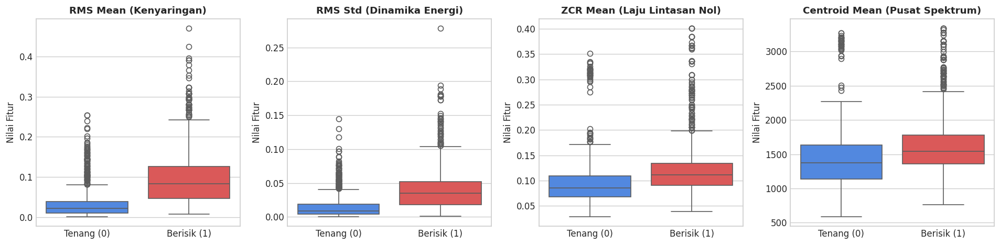

# Data Understanding: Karakteristik Data Audio & Eksplorasi Statistik

Tahap **Data Understanding** berfokus pada identifikasi sumber data, pemahaman karakteristik fisik sinyal audio, spesifikasi teknis dataset akustik laboratorium, serta analisis eksplorasi data (*Exploratory Data Analysis* / EDA) untuk mengamati pemisahan distribusi statistik antara kondisi **Tenang** dan **Berisik**.

---

## 1. Karakteristik & Spesifikasi Sinyal Audio Akustik

Sinyal audio merupakan gelombang tekanan mekanis yang merambat melalui media udara dan ditangkap oleh membran mikrofon menjadi sinyal tegangan analog kontinu, yang selanjutnya disampling ke format digital (*Digital Audio*).

### Parameter Teknis Audio:
* **Frekuensi Sampling (*Sampling Rate* / $f_s$):** Ditetapkan seragam sebesar **$16.000\text{ Hz}$ ($16\text{ kHz}$)**.  
  *Menurut Teorema Nyquist-Shannon*, frekuensi sampling $16\text{ kHz}$ mampu merekonstruksi komponen frekuensi hingga $8\text{ kHz}$ ($\frac{f_s}{2}$). Rentang frekuensi $0 - 8\text{ kHz}$ mencakup seluruh spektrum dasar (*fundamental frequency* $F_0$) dan formulan harmonik vokal percakapan manusia ($85 - 3.400\text{ Hz}$).
* **Saluran Suara (*Channels*):** Dikonversi menjadi **Mono (1 Kanal)**. Mengurangi redundansi spasial stereo dan memastikan keseragaman komputasi inferensi.
* **Format File Sumber:** File terkompresi dan tanpa kompresi dengan ekstensi `.wav`, `.mp3`, dan `.ogg`.
* **Dimensi Deret Waktu (*Time-Series Dimension*):** Satu detik audio pada frekuensi sampling $16\text{ kHz}$ menghasilkan $16.000$ titik data diskrit. Satu segmen audio $5\text{ detik}$ memiliki panjang vektor $80.000$ titik sampel ($N = 16.000 \times 5 = 80.000$).

```
        Sinyal Audio Kontinu (Tekanan Udara)
                     |
                     v
   [Sampling Analog-to-Digital Converter: 16 kHz]
                     |
                     v
       Deret Waktu Diskrit: x[n], n = 0, 1, ..., 79.999
    (80.000 titik sampel per segmen analisis 5 detik)
```

---

## 2. Taksonomi Kelas Kebisingan Laboratorium

Dataset dikelompokkan ke dalam 2 kelas biner terawasi (*Supervised Binary Classification*):

| Label Numerik | Nama Kelas | Deskripsi Akustik | Komponen Suara Dominan |
| :---: | :--- | :--- | :--- |
| **0** | **Tidak Berisik / Tenang** | Suasana wajar laboratorium yang tertib dan kondusif untuk belajar. | Suara hening (*silence*), ketikan tuts *keyboard*, klik tombol *mouse*, desau pendingin udara (AC), dan dengung stabil kipas *rack server*. |
| **1** | **Berisik / Ramai** | Kegaduhan suara manusia yang mengganggu konsentrasi dan melampaui batas toleransi. | Percakapan banyak orang sekaligus, diskusi kelompok yang meninggi, tawa, candaan, seruan spontan, dan kerumunan vokal aktif. |

---

## 3. Profil Dataset Rekaman Asli

Dataset dikumpulkan secara langsung di lingkungan laboratorium Departemen Teknik Informatika UTM dan dikemas dalam dua file arsip terpisah:
1. `berisik.zip` : Berisi rekaman suasana ruangan saat kondisi ramai dan berisik.
2. `non-berisik.zip` : Berisi rekaman suasana ruangan saat kondisi hening dan wajar.

### Distribusi File Rekaman Asli:
Proses inspeksi direktori mengekstraksi seluruh file audio yang valid (mengabaikan metadata sistem operasi seperti `__MACOSX` atau file bertanda `._*`):

```python
# ==============================================================================
# PEMERIKSAAN DISTRIBUSI FILE REKAMAN ASLI
# ==============================================================================
EXT = (".wav", ".mp3", ".ogg")
rows = []

for zpath, folder, label in [("berisik.zip", "data/berisik", 1), ("non-berisik.zip", "data/tidak_berisik", 0)]:
    for p in Path(folder).rglob("*"):
        if p.suffix.lower() in EXT and "__MACOSX" not in p.parts and not p.name.startswith("._"):
            rows.append((str(p), label))

files_df = pd.DataFrame(rows, columns=["path", "label"])
print(files_df["label"].value_counts().rename({1: "Berisik (Kelas 1)", 0: "Tidak Berisik (Kelas 0)"}))
```

**Output Distribusi:**
```text
Total file rekaman asli terdeteksi:
label
Berisik (Kelas 1)          100
Tidak Berisik (Kelas 0)    100
Name: count, dtype: int64
```

> **Keseimbangan Kelas Ideal (*Balanced Dataset*)**:  
> Dataset awal berada dalam kondisi seimbang sempurna ($100\text{ file}$ Berisik : $100\text{ file}$ Tenang), sehingga evaluasi awal tidak dipengaruhi oleh ketimpangan kelas mayoritas/minoritas.

---

## 4. Eksplorasi Data Awal (*Exploratory Data Analysis* - EDA)

Untuk memahami bagaimana karakteristik fisik gelombang audio membedakan kondisi Tenang dan Berisik, dilakukan analisis komparatif terhadap 4 fitur akustik kunci:
1. **`rms_mean`**: Rata-rata daya energi kenyaringan fisik gelombang audio.
2. **`rms_std`**: Simpangan baku fluktuasi energi, mencerminkan ritme dinamika intonasi kata vs desau statis.
3. **`zcr_mean`**: Rata-rata frekuensi perubahan tanda gelombang per detik (*Zero Crossing Rate*).
4. **`centroid_mean`**: Titik berat spektrum frekuensi audio (*Spectral Centroid* / kecerahan nada).

### Kode Visualisasi Boxplot EDA:

```python
# ==============================================================================
# VISUALISASI BOXPLOT DISTRIBUSI FITUR KUNCI (EDA)
# ==============================================================================
fig, axes = plt.subplots(1, 4, figsize=(16, 4))
eda_cols = ["rms_mean", "rms_std", "zcr_mean", "centroid_mean"]
titles = [
    "RMS Mean (Kenyaringan)", 
    "RMS Std (Dinamika Energi)", 
    "ZCR Mean (Laju Lintasan Nol)", 
    "Centroid Mean (Pusat Spektrum)"
]

for ax, col, title in zip(axes, eda_cols, titles):
    sns.boxplot(data=df, x="label", y=col, ax=ax, palette=["#3b82f6", "#ef4444"])
    ax.set_title(title, fontsize=11, fontweight="bold")
    ax.set_xticklabels(["Tenang (0)", "Berisik (1)"])
    ax.set_xlabel("")
    ax.set_ylabel("Nilai Fitur")

plt.tight_layout()
plt.show()

# Rata-rata fitur utama per kelas
print("Rata-rata Nilai Fitur Antar Kelas:")
print(df.groupby("label")[eda_cols].mean().rename(index={0: "Tenang (0)", 1: "Berisik (1)"}).round(4))
```

### Hasil Visualisasi Distribusi:



### Rangkuman Rata-rata Nilai Fitur Antar Kelas:

| Fitur Akustik | Rata-rata Kelas Tenang (0) | Rata-rata Kelas Berisik (1) | Rasio Perbedaan ($1 : 0$) | Interpretasi Fisis |
| :--- | :---: | :---: | :---: | :--- |
| **`rms_mean`** | **$0.0345$** | **$0.0968$** | **$2.81\times$** | Energi kenyaringan kelas berisik hampir **3 kali lipat lebih besar** dibandingkan kondisi tenang. |
| **`rms_std`** | **$0.0159$** | **$0.0396$** | **$2.49\times$** | Fluktuasi suku kata manusia menghasilkan dinamika naik-turun energi yang sangat tinggi, sedangkan suasana tenang memiliki energi yang relatif konstan. |
| **`zcr_mean`** | **$0.0959$** | **$0.1230$** | **$1.28\times$** | Fonem konsonan frikatif (/s/, /t/, /k/) dan artikulasi bicara menghasilkan perlintasan nol yang lebih kerap. |
| **`centroid_mean`** | **$1431.29\text{ Hz}$** | **$1619.79\text{ Hz}$** | **$1.13\times$** | Titik berat spektrum frekuensi kelas berisik bergeser lebih tinggi ke arah pita resonansi vokal manusia. |

---

## 5. Kesimpulan Tahap Data Understanding

1. **Kelayakan Fitur Akustik:** Terdapat pemisahan distribusi nilai yang sangat jelas antara kelas Tenang dan Berisik, terutama pada indikator energi (`rms_mean` dan `rms_std`). Hal ini membuktikan bahwa sinyal audio dapat dipisahkan secara terawasi menggunakan algoritma klasifikasi.
2. **Kebutuhan Fitur Resolusi Spektral (MFCC):** Walaupun fitur dasar seperti RMS dan Centroid menunjukkan pemisahan yang baik, fitur-fitur tersebut belum cukup untuk membedakan percakapan vokal manusia dari suara dentuman sesaat (kursi bergeser atau pintu terbanting). Oleh karena itu, diperlukan koefisien **Mel-Frequency Cepstral Coefficients (MFCC)** yang menangkap timbre dan anatomi saluran vokal manusia secara rinci pada tahap persiapan data (*Data Preparation*).

