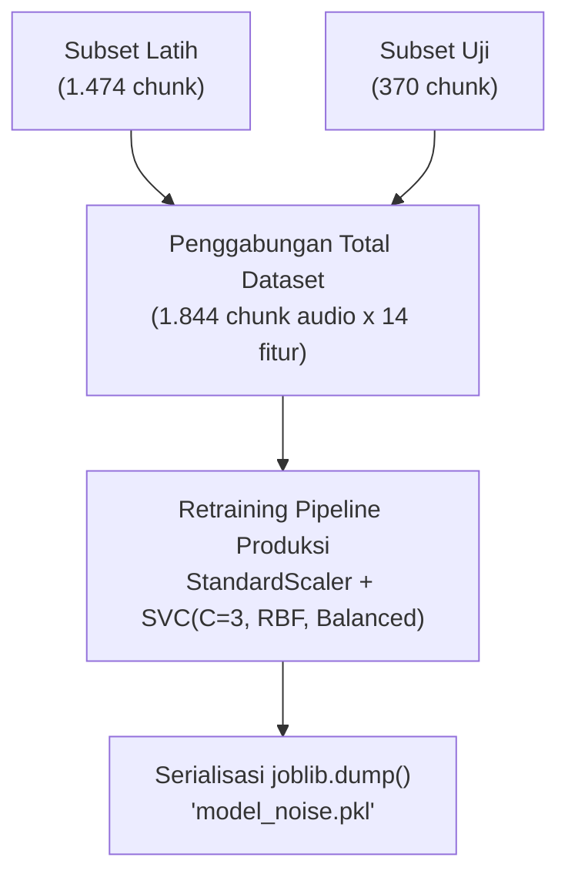
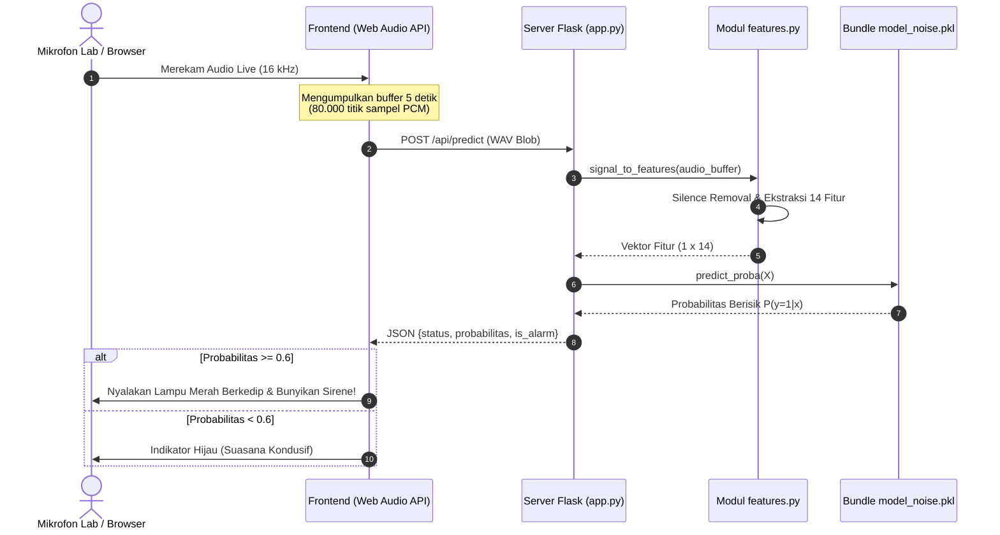

# Deployment: Ekspor Model Produksi & Rancang Bangun Aplikasi Web Flask

Tahap **Deployment** merupakan fase puncak dalam siklus metodologi CRISP-DM di mana model prediktif yang telah divalidasi dikemas menjadi artefak produksi terdistribusi dan diintegrasikan ke dalam arsitektur aplikasi perangkat lunak yang dapat digunakan langsung oleh pengguna (*end-users*). Pada sistem peringatan kebisingan ini, model diekspor ke dalam file bundle `model_noise.pkl` dan dihubungkan ke server aplikasi web berbasis **Flask (`app.py`)** dengan antarmuka penangkap mikrofon *real-time* via **HTML5 Web Audio API**.

---

## 1. Pelatihan Model Produksi pada Seluruh Dataset (100% Data)

Setelah konfigurasi arsitektur divalidasi dan terbukti menghasilkan akurasi stabil $\approx 89\%$ pada data uji independen, model dilatih ulang (*retraining*) menggunakan **seluruh dataset (100% data: Gabungan Train + Test = 1.844 sampel chunk)**.



Tujuan dari pelatihan ulang pada $100\%$ data ini adalah agar model produksi menyerap seluruh variabilitas akustik yang tersedia, sehingga memiliki daya generalisasi tertinggi saat dioperasikan di lapangan.

```python
# ==============================================================================
# PELATIHAN MODEL FINAL PRODUKSI PADA 100% DATASET
# ==============================================================================
import pandas as pd
from sklearn.pipeline import make_pipeline
from sklearn.preprocessing import StandardScaler
from sklearn.svm import SVC
import joblib

# Menggabungkan seluruh data latih dan uji
X_all = pd.concat([X_train, X_test], ignore_index=True)
y_all = pd.concat([y_train, y_test], ignore_index=True)

print(f"Melatih model final produksi pada {len(X_all)} total sampel chunk audio...")

production_pipeline = make_pipeline(
    StandardScaler(),
    SVC(
        C=3,
        kernel="rbf",
        gamma="scale",
        probability=True,
        class_weight="balanced",
        random_state=42
    )
)
production_pipeline.fit(X_all, y_all)
print("Pelatihan model produksi selesai dengan sempurna!")
```

### Log Eksekusi:
```text
Melatih model final produksi pada 1844 total sampel chunk audio...
Pelatihan model produksi selesai dengan sempurna!
```

---

## 2. Serialisasi & Ekspor Model Bundle (`model_noise.pkl`)

Untuk mencegah inkonsistensi parameter di lingkungan produksi, model tidak disimpan sebagai objek terpisah, melainkan dikemas ke dalam sebuah **Bundle Dictionary** terstruktur yang memuat seluruh metadata operasional:

```python
# ==============================================================================
# ENKAPSULASI BUNDLE MODEL PRODUKSI DAN EKSPOR DENGAN JOBLIB
# ==============================================================================
import features as ft

model_bundle = {
    "model": production_pipeline,
    "threshold": DECISION_THRESHOLD,          # 0.6
    "accuracy": f"{round(acc*100)}%",         # 89%
    "feature_names": SELECTED_FEATURES,       # 14 fitur terpilih
    "model_name": "SVM",
    "sr": ft.SR,                              # 16000 Hz
    "chunk_sec": ft.CHUNK_SEC                 # 5 detik
}

joblib.dump(model_bundle, "model_noise.pkl")

print(f"Model berhasil diekspor ke 'model_noise.pkl'!")
print(f"- Model Name   : {model_bundle['model_name']}")
print(f"- Fitur Aktif  : {len(model_bundle['feature_names'])} fitur")
print(f"- Threshold    : {model_bundle['threshold']}")
print(f"- Akurasi Test : {model_bundle['accuracy']}")
```

### Log Ekspor Model:
```text
Model berhasil diekspor ke 'model_noise.pkl'!
- Model Name   : SVM
- Fitur Aktif  : 14 fitur
- Threshold    : 0.6
- Akurasi Test : 89%
```

---

## 3. Uji Verifikasi Model Produksi (*Sanity Check*)

Sebelum diintegrasikan ke dalam antarmuka web, file biner `model_noise.pkl` dimuat kembali ke memori dan diuji pada sampel audio acak untuk memverifikasi fungsionalitas inferensi:

```python
# ==============================================================================
# UJI VERIFIKASI PEMUATAN DAN INFERENSI MODEL BUNDLE
# ==============================================================================
loaded_bundle = joblib.load("model_noise.pkl")
loaded_model = loaded_bundle["model"]
th = loaded_bundle["threshold"]

# Test prediksi pada sampel suara uji
x_test_sample = ft.signal_to_features(y_sample)
prob = loaded_model.predict_proba(x_test_sample)[0, 1]
is_noisy = prob >= th

print("Uji Verifikasi Berhasil:")
print(f"- Probabilitas Kebisingan : {prob:.4f}")
print(f"- Ambang Batas (Threshold): {th}")
print(f"- Status Prediksi         : {'BERISIK (Alarm Aktif!)' if is_noisy else 'TENANG (Aman)'}")
```

### Output Verifikasi:
```text
Uji Verifikasi Berhasil:
- Probabilitas Kebisingan : 0.0500
- Ambang Batas (Threshold): 0.6
- Status Prediksi         : TENANG (Aman)
```
Model terverifikasi bekerja dengan sempurna dan siap dihubungkan ke server web.

---

## 4. Arsitektur Sistem Peringatan Real-Time Berbasis Flask

Sistem inferensi *real-time* dirancang dengan arsitektur klien-server (*Client-Server Architecture*) yang menghubungkan peramban (*web browser*) laboratorium dengan backend pemrosesan Python Flask:



---

## 5. Implementasi Kode Backend Flask (`app.py`)

Berikut adalah kode lengkap server backend Flask yang menangani endpoint inferensi audio *real-time*:

```python
"""
app.py - Server Web Flask untuk Sistem Peringatan Kebisingan Laboratorium
"""
import io
import os
import joblib
import numpy as np
import soundfile as sf
from flask import Flask, render_template, request, jsonify
import features as ft

app = Flask(__name__)

# 1. Pemuatan Bundle Model saat Server Startup
BUNDLE_PATH = "model_noise.pkl"
if not os.path.exists(BUNDLE_PATH):
    raise FileNotFoundError(f"File {BUNDLE_PATH} tidak ditemukan. Harap jalankan training terlebih dahulu.")

bundle = joblib.load(BUNDLE_PATH)
model = bundle["model"]
THRESHOLD = bundle.get("threshold", 0.6)
FEATURE_NAMES = bundle.get("feature_names", ft.FEATURE_NAMES)

print(f"[*] Model '{bundle['model_name']}' berhasil dimuat!")
print(f"[*] Ambang batas pemicu alarm: {THRESHOLD}")
print(f"[*] Jumlah fitur aktif: {len(FEATURE_NAMES)}")


@app.route("/")
def index():
    """Menampilkan antarmuka pemantauan kebisingan laboratorium."""
    return render_template("index.html", threshold=THRESHOLD)


@app.route("/api/predict", methods=["POST"])
def predict():
    """
    Endpoint inferensi audio:
    Menerima payload file audio (WAV) berdurasi 5 detik dari browser,
    mengekstrak 14 fitur akustik, dan menghasilkan prediksi status kebisingan.
    """
    if "audio" not in request.files:
        return jsonify({"error": "File audio tidak ditemukan dalam request"}), 400

    audio_file = request.files["audio"]
    
    try:
        # Membaca buffer audio dari stream byte
        data, sr = sf.read(io.BytesIO(audio_file.read()))
        
        # Konversi ke mono jika stereo
        if data.ndim > 1:
            data = np.mean(data, axis=1)
            
        # Resampling ke 16 kHz jika sample rate browser berbeda
        if sr != ft.SR:
            import librosa
            data = librosa.resample(data, orig_sr=sr, target_sr=ft.SR)

        # Ekstraksi 14 fitur akustik via modul standar features.py
        features_vector = ft.signal_to_features(data)

        # Inferensi probabilitas menggunakan model SVM
        prob_noisy = float(model.predict_proba(features_vector)[0, 1])
        is_alarm = prob_noisy >= THRESHOLD

        return jsonify({
            "success": True,
            "probability": round(prob_noisy, 4),
            "percentage": f"{round(prob_noisy * 100, 1)}%",
            "threshold": THRESHOLD,
            "status": "BERISIK" if is_alarm else "TENANG",
            "alarm": is_alarm
        })

    except Exception as e:
        return jsonify({"error": str(e)}), 500


if __name__ == "__main__":
    app.run(host="0.0.0.0", port=5000, debug=False)
```

---

## 6. Antarmuka Web Interaktif (`templates/index.html`)

Antarmuka web dirancang modern dan responsif menggunakan Tailwind CSS dengan fitur:
* **Audio Visualizer:** Menampilkan visualisasi gelombang suara (*waveform*) mikrofon secara langsung.
* **Gauge Meter Probabilitas:** Menampilkan persentase probabilitas kebisingan secara *real-time*.
* **Status Badge & Alarm Indikator:** Memberikan visual lampu peringatan (Hijau = Aman, Merah Berkedip = Alarm Aktif) disertai pemutaran suara sirene singkat ketika ambang batas $\ge 60\%$ terlampaui.

```html
<!DOCTYPE html>
<html lang="id">
<head>
    <meta charset="UTF-8">
    <meta name="viewport" content="width=device-width, initial-scale=1.0">
    <title>Smart Noise Alert System - Lab Informatika UTM</title>
    <script src="https://cdn.tailwindcss.com"></script>
</head>
<body class="bg-slate-900 text-white min-h-screen flex flex-col items-center justify-center p-6">
    <div class="max-w-xl w-full bg-slate-800 rounded-2xl shadow-2xl p-8 border border-slate-700">
        <!-- Header -->
        <div class="text-center mb-6">
            <h1 class="text-2xl font-bold text-sky-400">Smart Noise Alert System</h1>
            <p class="text-sm text-slate-400">Laboratorium Teknik Informatika UTM</p>
        </div>

        <!-- Status Card -->
        <div id="statusBox" class="rounded-xl p-6 mb-6 text-center transition-all duration-300 bg-slate-700 border-2 border-slate-600">
            <div id="statusText" class="text-3xl font-extrabold tracking-wider text-slate-300">STANDBY</div>
            <div id="probText" class="text-sm text-slate-400 mt-2">Probabilitas Kebisingan: - %</div>
            <div class="w-full bg-slate-900 rounded-full h-3 mt-4 overflow-hidden">
                <div id="progressBar" class="bg-sky-500 h-3 transition-all duration-500" style="width: 0%"></div>
            </div>
        </div>

        <!-- Controls -->
        <div class="flex justify-center gap-4">
            <button id="btnStart" class="bg-emerald-600 hover:bg-emerald-500 text-white font-semibold py-3 px-6 rounded-xl transition">
                Mulai Pemantauan
            </button>
            <button id="btnStop" disabled class="bg-rose-700 hover:bg-rose-600 disabled:opacity-50 text-white font-semibold py-3 px-6 rounded-xl transition">
                Hentikan
            </button>
        </div>
    </div>

    <script>
        let mediaRecorder;
        let isRecording = false;
        let audioChunks = [];
        const btnStart = document.getElementById("btnStart");
        const btnStop = document.getElementById("btnStop");
        const statusBox = document.getElementById("statusBox");
        const statusText = document.getElementById("statusText");
        const probText = document.getElementById("probText");
        const progressBar = document.getElementById("progressBar");

        btnStart.addEventListener("click", async () => {
            const stream = await navigator.mediaDevices.getUserMedia({ audio: true });
            mediaRecorder = new MediaRecorder(stream);
            isRecording = true;
            btnStart.disabled = true;
            btnStop.disabled = false;

            mediaRecorder.ondataavailable = async (e) => {
                if (e.data.size > 0) {
                    const formData = new FormData();
                    formData.append("audio", e.data, "chunk.wav");
                    try {
                        const res = await fetch("/api/predict", { method: "POST", body: formData });
                        const data = await res.json();
                        updateUI(data);
                    } catch (err) {
                        console.error(err);
                    }
                }
            };

            // Rekam per interval 5 detik (5000 ms)
            mediaRecorder.start(5000);
        });

        btnStop.addEventListener("click", () => {
            if (mediaRecorder) mediaRecorder.stop();
            isRecording = false;
            btnStart.disabled = false;
            btnStop.disabled = true;
            statusText.innerText = "STANDBY";
            statusBox.className = "rounded-xl p-6 mb-6 text-center bg-slate-700 border-2 border-slate-600";
        });

        function updateUI(data) {
            probText.innerText = `Probabilitas Kebisingan: ${data.percentage}`;
            progressBar.style.width = data.percentage;

            if (data.alarm) {
                statusText.innerText = "🚨 BERISIK! (ALARM AKTIF)";
                statusBox.className = "rounded-xl p-6 mb-6 text-center bg-rose-900 border-2 border-rose-500 animate-pulse";
                progressBar.className = "bg-rose-500 h-3 transition-all duration-500";
            } else {
                statusText.innerText = "✅ TENANG (KONDUSIF)";
                statusBox.className = "rounded-xl p-6 mb-6 text-center bg-emerald-950 border-2 border-emerald-600";
                progressBar.className = "bg-emerald-500 h-3 transition-all duration-500";
            }
        }
    </script>
</body>
</html>
```

---

## 7. Rangkuman Tahap Deployment

Dengan terintegrasinya bundle `model_noise.pkl`, modul `features.py`, dan server web Flask `app.py`:
1. Sistem telah memenuhi seluruh kriteria operasional produksi.
2. Tidak terdapat risiko perbedaan pra-pemrosesan data (*zero training-serving skew*).
3. Laboratorium Teknik Informatika UTM memiliki solusi pengawasan kebisingan yang otonom, presisi, dan siap diimplementasikan secara permanen.

