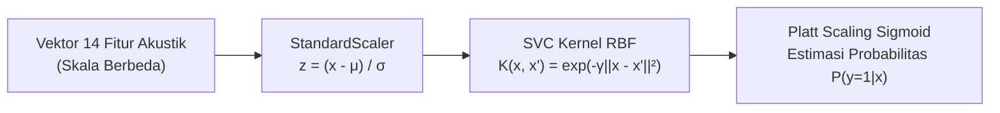

# Modeling: Arsitektur Pipeline Support Vector Machine (SVM)

Tahap **Modeling** berfokus pada perancangan arsitektur, landasan matematis, konfigurasi hiperparameter, dan pelatihan model pembelajaran mesin terawasi (*Supervised Machine Learning*) **Support Vector Machine (SVM)** dengan **Kernel Radial Basis Function (RBF)** untuk mengklasifikasikan kondisi kebisingan ruangan secara akurat dan probabilistik.

---

## 1. Landasan Teori Support Vector Machine (SVM)

Support Vector Machine (SVM) merupakan algoritma pembelajaran mesin berbasis teori optimasi konveks yang bekerja dengan mencari bidang pembatas (*hyperplane*) optimal dengan margin terbesar (*Maximum Margin Classifier*) yang memisahkan dua kelas data.

```
                   ^  Fitur x2
                   |
                   |      (Kelas 1: Berisik)
                   |           +   +
                   |         +   (+) <-- Support Vector
                   |       ---------\------------------ (w^T x + b = +1)
                   |                 \       ^
                   |                  \      | Margin = 2 / ||w||
                   |   (Hyperplane)    \     v
                   |   w^T x + b = 0    \
                   |                     \   ^
                   |                      \  |
                   |       ----------------\----------- (w^T x + b = -1)
                   |             (-) <-- Support Vector
                   |          -    -
                   |       -   -    (Kelas 0: Tenang)
                   +---------------------------------------> Fitur x1
```

Titik-titik data latih yang terletak tepat pada batas margin disebut sebagai **Support Vectors**. Karena hanya titik-titik penyangga inilah yang menentukan orientasi bidang pemisah, SVM memiliki ketahanan luar biasa terhadap *outliers* yang berada jauh dari batas kelas.

### Formulasi Optimasi Soft-Margin:
Karena sinyal audio nyata memiliki tumpang tindih (*overlap*) alami antara suara vokal dan derau latar, diterapkan pendekatan *Soft-Margin SVM* dengan menambahkan variabel kelonggaran (*slack variable* $\xi_i \ge 0$):

$$\min_{\mathbf{w}, b, \boldsymbol{\xi}} \frac{1}{2} \|\mathbf{w}\|^2 + C \sum_{i=1}^{N} \xi_i$$

Dengan kendala (*constraints*):
$$y_i (\mathbf{w}^T \phi(\mathbf{x}_i) + b) \ge 1 - \xi_i, \quad \xi_i \ge 0, \quad \forall i \in \{1, 2, \dots, N\}$$

Di mana:
* $\mathbf{w}$ adalah vektor bobot tegak lurus terhadap *hyperplane*.
* $b$ adalah bias skalar penentu pergeseran bidang pembatas.
* $C > 0$ adalah parameter penalti regularisasi.
* $\xi_i$ adalah toleransi kesalahan pelanggaran margin untuk sampel ke-$i$.
* $y_i \in \{-1, +1\}$ adalah label kelas biner (Tenang vs Berisik).
* $\phi(\mathbf{x})$ adalah fungsi pemetaan fitur ke ruang berdimensi lebih tinggi.

---

## 2. Komponen Utama Arsitektur Pipeline Model

Untuk menjamin alur pemrosesan data yang steril, bebas dari kebocoran data (*data leakage*), dan mudah direplikasi pada lingkungan produksi, model dibangun menggunakan modul `make_pipeline` dari Scikit-Learn dengan komponen:



### A. Standardisasi Fitur (`StandardScaler`)
SVM sangat sensitif terhadap rentang skala nilai fitur karena fungsi kernelnya menghitung jarak Euclidean $\|\mathbf{x}_i - \mathbf{x}_j\|^2$. 
* Fitur seperti `centroid_mean` memiliki nilai dalam orde ribuan ($1.400 - 1.800\text{ Hz}$).
* Fitur seperti `rms_mean` memiliki nilai desimal sangat kecil ($0.01 - 0.15$).

Jika tidak distandardisasi, fitur dengan magnitudo besar akan mendominasi perhitungan jarak dan menenggelamkan informasi fitur-fitur beramplitudo kecil. `StandardScaler` mentransformasikan setiap fitur secara independen sehingga memiliki rata-rata $\mu = 0$ dan variansi $\sigma^2 = 1$:

$$z = \frac{x - \mu}{\sigma}$$

### B. Kernel Radial Basis Function (RBF / Gaussian Kernel)
Batas pemisah antara suara percakapan berisik dan suara tenang di ruangan laboratorium bersifat non-linier dan kompleks. Kernel RBF memetakan vektor fitur ke ruang Hilbert berdimensi tak hingga (*infinite-dimensional reproducing kernel Hilbert space*) melalui trik kernel (*kernel trick*):

$$K(\mathbf{x}, \mathbf{x}') = \exp\left(-\gamma \|\mathbf{x} - \mathbf{x}'\|^2\right)$$

Di mana parameter $\gamma$ mengontrol jangkauan pengaruh dari satu sampel pelatihan. Digunakan nilai bawaan optimal `gamma='scale'`:
$$\gamma = \frac{1}{n_{\text{fitur}} \cdot \text{Var}(X)} = \frac{1}{14 \cdot \text{Var}(X)}$$

### C. Parameter Regularisasi $C = 3$
Parameter $C$ mengatur kompromi (*trade-off*) antara memaksimalkan lebar margin dengan meminimalkan penalti kesalahan klasifikasi data latih:
* Nilai $C$ yang terlalu kecil ($C \le 0.1$) menghasilkan margin yang terlalu lebar (*underfitting*), menyebabkan model gagal menangkap pola unik suara gaduh.
* Nilai $C$ yang terlalu besar ($C \ge 50$) memberikan penalti sangat berat terhadap setiap pelanggaran data latih (*overfitting*), membuat model kaku terhadap variasi akustik baru.
* Nilai **$C = 3$** terbukti empiris memberikan toleransi yang proporsional terhadap dinamika variabilitas suara di laboratorium tanpa terjebak *overfitting*.

### D. Penyeimbang Bobot Kelas (`class_weight='balanced'`)
Penyeimbang bobot otomatis menetapkan penalti galat yang berbanding terbalik dengan frekuensi kemunculan kelas dalam data latih:

$$w_c = \frac{N}{K \cdot N_c}$$

Di mana $N$ adalah total sampel latih ($1.474$), $K$ adalah jumlah kelas ($2$), dan $N_c$ adalah jumlah sampel kelas ke-$c$. Hal ini memastikan model tidak memiliki bias implisit ke salah satu kelas.

### E. Estimasi Probabilitas Kontinu (*Platt Scaling*, `probability=True`)
Secara mendasar, model SVM menghasilkan nilai jarak fungsi keputusan tak terbatas $f(\mathbf{x}) = \mathbf{w}^T \phi(\mathbf{x}) + b$. Namun dalam sistem alarm pintar, kita memerlukan nilai probabilitas kontinu antara $0.0$ s.d. $1.0$ agar ambang batas alarm dapat diatur secara fleksibel.

Melalui metode **Platt Scaling** (mengaktifkan parameter `probability=True`), dilatih fungsi sigmoid regresi logistik terkalibrasi di atas skor margin $f(\mathbf{x})$:

$$P(y=1|\mathbf{x}) = \frac{1}{1 + \exp(A \cdot f(\mathbf{x}) + B)}$$

Parameter skalar $A$ dan $B$ diestimasi secara optimal melalui validasi silang internal 5-lipat (*internal 5-fold cross-validation*) menggunakan algoritma *Maximum Likelihood Estimation* (MLE).

---

## 3. Implementasi Kode Pelatihan Pipeline SVM

```python
# ==============================================================================
# PEMBANGUNAN PIPELINE STANDARDSCALER + SVC RBF DAN PELATIHAN MODEL
# ==============================================================================
from sklearn.pipeline import make_pipeline
from sklearn.preprocessing import StandardScaler
from sklearn.svm import SVC

# Membangun Pipeline Lengkap
svm_pipeline = make_pipeline(
    StandardScaler(),
    SVC(
        C=3,
        kernel="rbf",
        gamma="scale",
        probability=True,
        class_weight="balanced",
        random_state=42
    )
)

# Melatih Model pada Data Latih dengan 14 Fitur Terpilih
print("Melatih model SVM (StandardScaler + SVC RBF)...")
svm_pipeline.fit(X_train, y_train)
print("Model SVM berhasil dilatih pada 1.474 sampel data latih!")
```

### Log Eksekusi Pelatihan:
```text
Melatih model SVM (StandardScaler + SVC RBF)...
Model SVM berhasil dilatih pada 1.474 sampel data latih!
```

---

## 4. Evaluasi Kompleksitas & Karakteristik Model Terlatih

Pipeline model SVM yang dihasilkan memiliki beberapa keunggulan teknis:
1. **Daya Simpan Ringkas (*Lightweight Footprint*):** Model yang telah dilatih hanya menyimpan bobot vektor pendukung (*support vectors*) terpilih, bukan keseluruhan dataset, sehingga ukuran berkas biner model berukuran sangat kecil ($< 500\text{ KB}$).
2. **Determinisme Inferensi:** Setelah bobot $\mathbf{w}$ dan bias $b$ terkunci, proses prediksi untuk sampel baru hanya melibatkan perhitungan fungsi eksponensial Gaussian RBF dan fungsi sigmoid Platt Scaling, yang dapat diselesaikan dalam hitungan mikrodetik pada prosesor standar.

