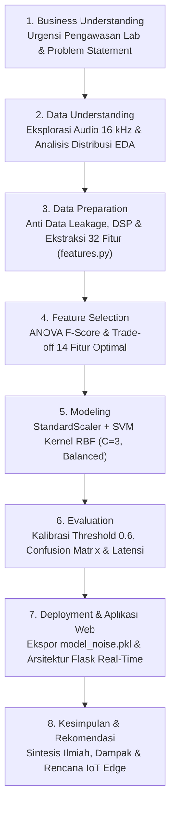

# Sistem Peringatan Kebisingan Cerdas (Smart Noise Alert System)

## Klasifikasi Kebisingan Berbasis Analisis Sinyal Akustik & Support Vector Machine (SVM)
**Studi Kasus:** Laboratorium Teknik Informatika, Universitas Trunojoyo Madura (UTM)  
**Mata Kuliah:** Proyek Sains Data

---

Dokumentasi ini menyajikan implementasi menyeluruh sistem cerdas pendeteksi dan pengklasifikasi kebisingan ruangan laboratorium berbasis pemrosesan sinyal digital (*Digital Signal Processing* / DSP) dan algoritma pembelajaran mesin terawasi (*Supervised Machine Learning*) **Support Vector Machine (SVM)** dengan **Kernel Radial Basis Function (RBF)**. Sistem ini dirancang untuk menggantikan kelemahan sensor desibel (dB) konvensional yang rentan terhadap peringatan palsu (*false alarm*), sehingga mampu mendeteksi kegaduhan percakapan dan diskusi kelompok mahasiswa secara objektif, otomatis, dan *real-time*.

---

### Ringkasan Eksekutif & Metadata Proyek

* **Topik / Domain:** Penambangan Sains Data & Pemrosesan Sinyal Akustik Audio (*Acoustic Signal Processing & Audio Pattern Recognition*).
* **Lokasi Studi Kasus:** Laboratorium Komputasi & Pemrograman, Departemen Teknik Informatika, Universitas Trunojoyo Madura (UTM).
* **Metodologi Pengembangan:** **CRISP-DM (Cross-Industry Standard Process for Data Mining)** 7 Tahapan Terstruktur.
* **Format Data Input:** File audio (.wav, .mp3, .ogg) diseragamkan ke format **16.000 Hz (16 kHz, Mono)**.
* **Volume Dataset Rekaman Asli:**
  * 100 file audio rekaman suasana **Berisik** (Kelas 1 — percakapan ramai, tawa, diskusi intensif).
  * 100 file audio rekaman suasana **Tidak Berisik / Tenang** (Kelas 0 — hening, ketikan keyboard, klik mouse, dengung kipas server).
  * Total: **200 file rekaman audio mandiri**.
* **Segmentasi Audio & Volume Sampel Tabular:**
  * Segmentasi: *Chunking* berdurasi **5 detik (80.000 sampel)** per segmen analisis dengan *silence removal* (`top_db=25`).
  * Total Sampel *Chunk*: **1.844 sampel data tabular** (1.474 data latih : 370 data uji).
* **Pencegahan Kebocoran Data (*Anti Data Leakage*):**
  * *Stratified Train-Test Split* (80% : 20%) dilakukan secara ketat pada **level file rekaman asli** sebelum proses *chunking*, menjamin data uji berasal dari sumber rekaman yang belum pernah didengar model.
* **Rekayasa & Seleksi Fitur:**
  * **32 Fitur Akustik Dasar:** Root Mean Square Energy (RMS), Spectral Centroid, Zero Crossing Rate (ZCR), dan Mel-Frequency Cepstral Coefficients (MFCC 1–13 mean & std).
  * **Seleksi Fitur Terarah:** Seleksi fitur berbasis uji statistik **One-Way ANOVA F-Score (`f_classif`)** yang memangkas dimensi dari 32 fitur menjadi **14 Fitur Terbaik Terpilih** (reduksi dimensi > 55%).
* **Arsitektur Model Machine Learning:**
  * **Support Vector Machine (SVM)** dengan **Kernel RBF (*Radial Basis Function*)**, parameter regularisasi $C=3$, penyeimbang bobot kelas otomatis (`class_weight='balanced'`), standardisasi fitur (`StandardScaler`), dan estimasi probabilitas kontinu (*Platt Scaling*).
* **Kalibrasi Ambang Batas (*Decision Threshold*):**
  * Disetel secara optimal pada probabilitas **0.6 (60%)** untuk meminimalkan *false alarm* sekaligus menjaga sensitivitas (*recall* $\approx 88\%$).
* **Capaian Kinerja Model:**
  * **Akurasi Global Data Uji (Chunk Level):** **88.65% (~89%)** pada 370 segmen audio uji independen.
  * **Macro F1-Score:** **0.89** (Presisi Kelas Berisik: 92%, Recall Kelas Berisik: 84%).
  * **Akurasi Evaluasi Level File Rekaman Asli:** **92.50%** (37 dari 40 file rekaman uji terdeteksi tepat).
* **Uji Kecepatan Operasional (*Latency Benchmark*):**
  * Rata-rata waktu ekstraksi fitur + inferensi: **41.21 ms per chunk 5 detik** (95th Percentile: 49.48 ms), lolos standar inferensi *real-time* (< 1000 ms).
* **Artefak Produksi & Deployment:**
  * Model diekspor ke file bundle terenkapsulasi `model_noise.pkl` dan siap diintegrasikan secara *real-time* dengan server web Flask (`app.py`) dan mikrofon browser via Web Audio API.

---

### Sistematika Dokumentasi & Alur CRISP-DM

Dokumentasi Bab ini disusun secara sistematis dan komprehensif mengikuti alur metodologi standar industri sains data **CRISP-DM**:

1. [**Business Understanding**](Bussines_Understanding_suara.md)  
   Merumuskan latar belakang operasional laboratorium informatika UTM, kelemahan sensor desibel konvensional yang rentan *false alarm*, tujuan bisnis, sasaran teknis, pemangku kepentingan (*stakeholders*), dan kriteria keberhasilan.
2. [**Data Understanding**](Data_Understanding_suara.md)  
   Membedah karakteristik sinyal audio akustik mono 16 kHz, taksonomi biner (Kelas Berisik vs Tenang), profil 200 file rekaman asli, serta analisis eksplorasi data (EDA) distribusi 4 fitur kunci (`rms_mean`, `rms_std`, `zcr_mean`, `centroid_mean`).
3. [**Data Preparation & Feature Extraction**](Data_Preparation_suara.md)  
   Menjelaskan strategi *Anti Data Leakage* berbasis pembagian data pada level file rekaman asli, alur *Digital Signal Processing* (pembersihan hening `top_db=25` dan *chunking* 5 detik), formulasi matematis 32 fitur akustik dasar (RMS, Centroid, ZCR, MFCC), modul terpusat `features.py`, dan pembangunan tabel data tabular `dataset_fitur.csv`.
4. [**Feature Selection**](Feature_Selection_suara.md)  
   Menguraikan rasionalisasi pemangkasan fitur, metodologi uji statistik One-Way ANOVA F-Score, visualisasi ranking 20 fitur teratas, analisis *trade-off* variasi jumlah fitur $k \in [4, 32]$ terhadap akurasi dan F1-Score, penetapan 14 fitur terbaik terpilih (~89% akurasi), dan ekspor `dataset_fitur_14.csv`.
5. [**Modeling (Support Vector Machine)**](Modeling_suara.md)  
   Membahas landasan teori SVM *Maximum Margin Classifier*, formulasi kernel RBF Gaussian, kompromi regularisasi $C=3$, pembobotan kelas seimbang, estimasi probabilitas *Platt Scaling*, dan implementasi pipeline Scikit-Learn.
6. [**Evaluation & Threshold Calibration**](Evaluation_suara.md)  
   Menganalisis kalibrasi *decision threshold* optimal pada 0.6, menyajikan *Classification Report* lengkap, visualisasi *Confusion Matrix*, evaluasi agregasi level file rekaman asli (92.50%), analisis *Permutation Feature Importance*, dan uji latensi operasional (41.21 ms).
7. [**Deployment & Aplikasi Web Real-Time**](Deployment_Aplikasi_suara.md)  
   Menjelaskan pelatihan ulang model produksi pada 100% data, ekspor artefak `model_noise.pkl`, uji verifikasi inferensi, serta rancang bangun arsitektur aplikasi web *real-time* berbasis Flask `app.py` dan antarmuka mikrofon Web Audio API.
8. [**Kesimpulan & Rekomendasi**](Kesimpulan_Rekomendasi_suara.md)  
   Menyimpulkan temuan teknis sistem kecerdasan buatan pengenal suara, keunggulan komparatif terhadap sensor desibel fisik, dan rekomendasi implementasi perangkat keras *Edge AI / IoT* (Raspberry Pi/ESP32) di laboratorium.

