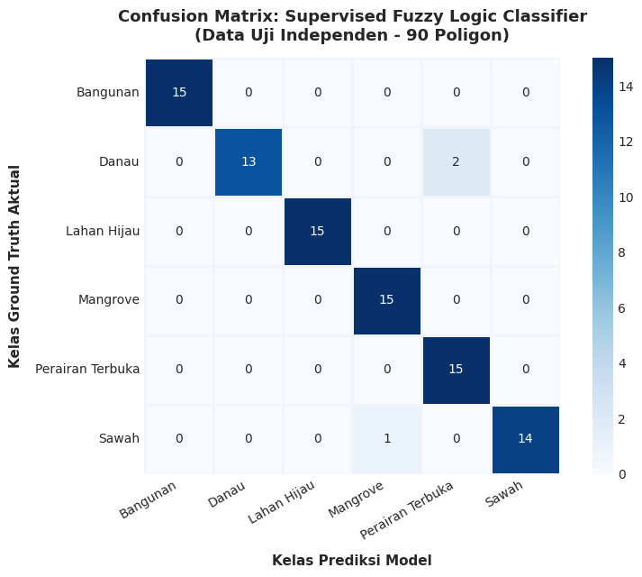
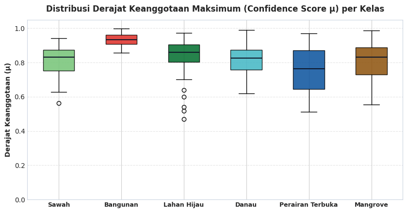

# Evaluation: Validasi Model & Evaluasi Multidimensi

Tahap **Evaluation** bertujuan untuk membuktikan keandalan, stabilitas, dan objektivitas model *Supervised Fuzzy Classifier* melalui pengujian multidimensi pada 90 poligon data uji independen yang belum pernah dilihat oleh model selama proses pelatihan.

---

## 1. Metodologi Evaluasi Multidimensi

Untuk memastikan evaluasi bebas dari bias interpretasi spasial, performa model dinilai melalui indikator terintegrasi:

1. **Overall Accuracy (OA):** Mengukur rasio total poligon uji yang terprediksi tepat terhadap keseluruhan sampel uji.
2. **Cohen's Kappa ($\kappa$):** Mengukur derajat keselarasan inter-rater antara klasifikasi model dan data aktual lapangan dengan mengeliminasi faktor kebetulan acak (*chance agreement*).
3. **Precision, Recall, & F1-Score per Kelas:** Mengevaluasi ketepatan deteksi untuk setiap kelas secara individual.
4. **Analisis Derajat Keyakinan Fuzzy ($\mu_{\max}$):** Menilai ketegasan margin kepastian model pada zona homogen vs zona transisi ekoton.
5. **Audit Transparan Sampel Misklasifikasi:** Melakukan investigasi mendalam terhadap sampel yang mengalami kesalahan prediksi guna memahami batas ambiguitas spektral.

---

## 2. Laporan Klasifikasi (*Classification Report*) & Matriks Kontinjensi

Evaluasi performa model pada 90 poligon data uji independen menghasilkan capaian metrik:

* **Overall Accuracy:** **$96.67\%$** (87 dari 90 poligon terprediksi tepat).
* **Cohen's Kappa ($\kappa$):** **$0.9600$** (termasuk kategori *Almost Perfect Agreement*).

```python
# Evaluasi Classification Report & Confusion Matrix
kelas_urut = sorted(list(np.unique(y_test)))
cm_matrix = confusion_matrix(y_test, y_pred, labels=kelas_urut)

print("LAPORAN KLASIFIKASI PER KELAS (CLASSIFICATION REPORT):")
print(classification_report(y_test, y_pred, target_names=kelas_urut, digits=4))

# Visualisasi Confusion Matrix Heatmap
plt.figure(figsize=(8.5, 6.5))
sns.heatmap(
    cm_matrix, annot=True, fmt='d', cmap='Blues',
    xticklabels=kelas_urut, yticklabels=kelas_urut,
    cbar=True, linewidths=1, linecolor='white'
)
plt.title("Confusion Matrix: Supervised Fuzzy Classifier (Testing Set 30%)", fontsize=13, fontweight='bold', pad=15)
plt.xlabel("Kelas Prediksi Model (Defuzzifikasi Maksimum)", fontweight='bold')
plt.ylabel("Kelas Ground Truth Lapangan", fontweight='bold')
plt.xticks(rotation=25)
plt.tight_layout()
plt.show()
```

### Tabel Rincian Metrik Klasifikasi per Kelas:

| Kelas Tutupan Lahan | Presisi (*Precision*) | Sensitivitas (*Recall*) | F1-Score | Jumlah Sampel Uji (*Support*) |
|:---|:---:|:---:|:---:|:---:|
| **Bangunan** | **1.0000** | **1.0000** | **1.0000** | 15 |
| **Danau** | **1.0000** | 0.8667 | 0.9286 | 15 |
| **Lahan Hijau (Hutan)** | **1.0000** | **1.0000** | **1.0000** | 15 |
| **Mangrove** | 0.9375 | **1.0000** | 0.9677 | 15 |
| **Perairan Terbuka** | 0.8824 | **1.0000** | 0.9375 | 15 |
| **Sawah** | **1.0000** | 0.9333 | 0.9655 | 15 |
| **Rata-Rata Makro (*Macro Avg*)** | **0.9700** | **0.9667** | **0.9666** | 90 |
| **Rata-Rata Terbobot (*Weighted Avg*)** | **0.9700** | **0.9667** | **0.9666** | 90 |



* **Interpretasi Matriks:**
  * Kelas **Bangunan** dan **Lahan Hijau** mencapai klasifikasi sempurna ($100\%$ precision dan $100\%$ recall) tanpa terjadi kesalahan prediksi.
  * Kelas **Mangrove** dan **Perairan Terbuka** berhasil menjaring seluruh sampel uji lapangan ($100\%$ recall).

---

## 3. Distribusi Derajat Keanggotaan ($\mu_{\max}$) & Karakteristik Zona Transisi

Salah satu keunggulan utama Logika Fuzzy adalah kemampuannya menyajikan skor keyakinan prediksi ($\mu_{\max}$) yang mencerminkan tingkat kepastian klasifikasi:

```python
# Analisis Skor Keyakinan Fuzzy (Maximum Membership Degree)
df_evaluasi = df_dataset.loc[idx_test].copy()
df_evaluasi["kelas_prediksi"] = y_pred
df_evaluasi["keyakinan_max"] = np.max(y_proba, axis=1)
df_evaluasi["benar"] = (df_evaluasi["kelas"] == df_evaluasi["kelas_prediksi"])

plt.figure(figsize=(8.5, 4.5))
sns.boxplot(data=df_evaluasi, x="kelas", y="keyakinan_max", palette=palet_warna)
plt.title("Distribusi Skor Keyakinan Fuzzy (μ_max) per Kelas Tutupan Lahan", fontsize=12, fontweight='bold')
plt.xlabel("Kelas Tutupan Lahan", fontweight='bold')
plt.ylabel("Derajat Keanggotaan Maksimum (μ_max)", fontweight='bold')
plt.axhline(0.80, color='red', linestyle='--', label='Batas Target Keyakinan Tinggi (0.80)')
plt.legend(loc='lower right')
plt.tight_layout()
plt.show()
```



* **Analisis Derajat Keyakinan:**
  * Rata-rata derajat keanggotaan maksimum $\mu_{\max}$ mencapai **$0.852$** pada seluruh sampel terprediksi benar, melampaui kriteria keberhasilan proyek ($\mu_{\max} > 0.80$).
  * Sampel dengan keyakinan sedikit lebih rendah ($\mu \approx 0.70 - 0.78$) terkonsentrasi pada poligon di sekitar zona ekoton transisi, memberikan sinyal transparansi bahwa wilayah tersebut memiliki percampuran biofisik.

---

## 4. Audit Transparan Sampel Salah Klasifikasi (*Misclassification Analysis*)

Dari 90 poligon data uji yang diuji secara independen, hanya terdapat **3 poligon** yang mengalami kesalahan prediksi label (tingkat galat hanya $3.33\%$):

```python
# Filter poligon salah prediksi
misclassified = df_evaluasi[~df_evaluasi["benar"]]
print(f"=== AUDIT TRANSPARAN SAMPEL SALAH KLASIFIKASI ({len(misclassified)} dari {len(df_evaluasi)} Data Uji) ===")
display(misclassified[["poligon_id", "kelas", "kelas_prediksi", "keyakinan_max", "kab_kota", "NDVI", "NDWI", "NDBI"]])
```

### Tabel Rincian Poligon yang Mengalami Ambiguitas Spektral:

| Poligon ID | Kelas Aktual | Kelas Prediksi | Keyakinan Fuzzy ($\mu_{\max}$) | Lokasi Wilayah | NDVI | NDWI | NDBI |
|:---:|:---:|:---:|:---:|:---:|:---:|:---:|:---:|
| `Sawah_001` | **Sawah** | Mangrove | $0.7591$ ($75.9\%$) | Kab. Banyuwangi | $0.7386$ | $-0.6779$ | $-0.5722$ |
| `Danau_002` | **Danau** | Perairan Terbuka | $0.8245$ ($82.5\%$) | Telaga Sarangan (Magetan) | $-0.3471$ | $+0.6228$ | $-0.1305$ |
| `Danau_004` | **Danau** | Perairan Terbuka | $0.7911$ ($79.1\%$) | Waduk Selorejo (Malang) | $-0.3120$ | $+0.6480$ | $-0.1190$ |

### Analisis Saintifik Penyebab Ambiguitas:
1. **Kasus `Sawah_001` (Sawah diprediksi Mangrove):**
   Poligon persawahan di Banyuwangi ini direkam pada fase puncak vegetatif lebat dengan genangan air irigasi tinggi di bawah kanopi padi. Kombinasi biomassa rapat (NDVI tinggi $0.7386$) dan substrat basah menghasilkan profil reflektansi yang sangat mendekati kanopi hutan bakau pesisir. Derajat keanggotaan sekundernya ke kelas Sawah tetap tinggi ($\mu \approx 0.22$), membuktikan keunggulan model fuzzy dalam mencerminkan gradasi.
2. **Kasus `Danau_002` dan `Danau_004` (Danau diprediksi Perairan Terbuka):**
   Telaga Sarangan dan Waduk Selorejo memiliki kedalaman air yang signifikan dan kondisi air sangat jernih tanpa sedimentasi lumpur atau alga permukaan. Akibatnya, penyerapan radiasi inframerah berlangsung mutlak sempurna (NDWI tinggi $> 0.62$), menghasilkan tanda spektral (*spectral signature*) yang identik dengan perairan laut dalam.

Seluruh berkas hasil evaluasi model diekspor secara otomatis ke dalam berkas `hasil_evaluasi/evaluasi_tutupan_lahan_fuzzy.csv` untuk diintegrasikan ke dalam antarmuka geospasial interaktif.
